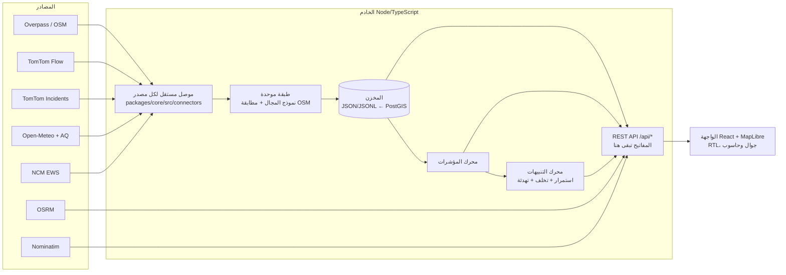

# نموذج المجال ومخطط البيانات وتدفقها

## نموذج المجال

صُمم النموذج قبل الكود، والكيانات مُعرّفة في `packages/core/src/domain/types.ts`.

| الكيان | الدور | ملاحظات |
|---|---|---|
| `Region` | منطقة أو مدينة | إضافة مدينة جديدة = إضافة عنصر في `regions.ts` (نطاق ومركز وأحياء عينة)، دون تعديل الموصلات أو الواجهة |
| `District` | **وحدة التجميع والمقارنة** | `boundaryQuality = polygon \| point_only`. لا نختلق حدودًا عند غيابها |
| `RoadSegment` | مقطع طريق من OSM | `directions` من وسوم `oneway`. و`isDistrictGateway` = يعبر حدود حي |
| `SegmentDirectionKey` | **وحدة التحليل**: `مقطع:اتجاه` | `fwd` = باتجاه ترتيب نقاط OSM، و`bwd` عكسه |
| `SpeedObservation` | قراءة سرعة لمقطع واتجاه | `observedAt` و`receivedAt` و`provenance` و`confidence` و`matchDistanceM` |
| `FlowObservation` | تدفق وكثافة وطوابير | من العدادات فقط. و`densityMethod` يميّز المقاس من المقدّر |
| `TrafficEvent` | حادث، عطل، أعمال طرق، إغلاق، سيول… | `verification`: verified / provider_reported / unverified |
| `WeatherObservation` | قيمة نموذجية لخلية شبكية | `kind`: current أو hourly، مع `provenance` تاريخي أو متوقع، و`spatialResolutionKm` |
| `WeatherWarning` | إنذار رسمي | `spatialScope`: منطقة أو محافظة. لا يُسقط على الحي كقياس |
| `WaterObservation` | تجمع مياه مؤكد | العمق اختياري (null = غير مقاس) |
| `Alert` + `ActionLogEntry` | تنبيه وسجل الإجراء ونتيجته | `dedupeKey` لمنع التكرار |
| `IndicatorValue` | قيمة مؤشر | إما `{available:true, value, unit, estimated?}` أو `{available:false, reason}`، والغياب لا يُمثَّل بصفر أبدًا |

## تدفق البيانات

1. **الجدولة** (`apps/server/src/ingest.ts`): قاعدة الطرق والأحياء أسبوعيًا (مع إعادة محاولة كل ساعة عند الفشل)، والطقس كل 15 دقيقة. أما TomTom فيُحسب فاصله آليًا من الحصة الشهرية وعدد نقاط المراقبة، وإنذارات المركز كل 10 دقائق.
2. **المطابقة**: يُطابق خط المزود مع أقرب مقطع OSM ضمن 30 م، ويُحدَّد الاتجاه بمقارنة اتجاه خط المزود باتجاه المقطع (تسامح 50°)، ويُرفض الاتجاه غير المسموح على الطرق ذات الاتجاه الواحد.
3. **الحفظ**: كل قراءة تُحفظ بوقت الرصد ووقت الاستلام والأصل والمصدر. السجل التاريخي في ملفات يومية `history/speed-YYYY-MM-DD.jsonl`.
4. **التقادم**: القراءة الأقدم من 20 دقيقة تُعرض رمادية «غير معروف»، والمصدر المتجاوز لأقصى عمره يُطلق تنبيه «تقادم مصدر».
5. **التحديث في الواجهة**: تُجلب الحالة كل دقيقة، ويُعرض «أحدث رصد للسرعات» من `observedAt` منفصلًا عن «آخر جلب من الخادم». إعادة الرسم لا تُعد تحديثًا للبيانات.

## المخطط الفيزيائي

مخطط PostgreSQL/PostGIS للتشغيل في [`db/schema.sql`](../db/schema.sql): يتضمن جداول الأحياء والطرق والقراءات والأحداث والطقس والإنذارات والمياه والتنبيهات والإجراءات والمصادر واختبارات الاتصال وسجل التدقيق، وفيه فهرس فريد يمنع أكثر من تنبيه نشط لنفس المفتاح.

## الخصوصية والأمان

- لا تُجمع بيانات شخصية. الموقع الجغرافي للمستخدم يُستخدم في المتصفح فقط بعد موافقته، ولا يُرسل إلى الخادم.
- المفاتيح في `.env` على الخادم فقط. وبلاطات TomTom تمر عبر وكيل `/api/tiles/...`. يتحقق اختبار e2e من غياب قيمة المفتاح في `/api/meta` وفي حزمة الواجهة.
- الإجراءات المعدِّلة (قواعد التنبيه، وسجل الإجراءات، والفحص) تتطلب `ADMIN_TOKEN`، وتُسجَّل في `audit.jsonl`.
- ترويسات أمان: `X-Content-Type-Options` و`X-Frame-Options` و`Referrer-Policy`، وحد لحجم الطلب 100 كيلوبايت.
